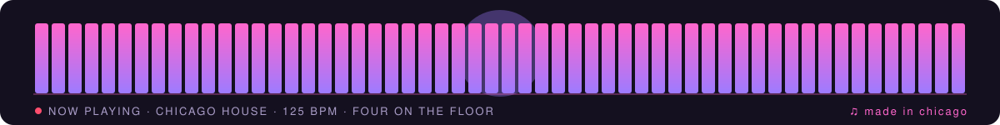
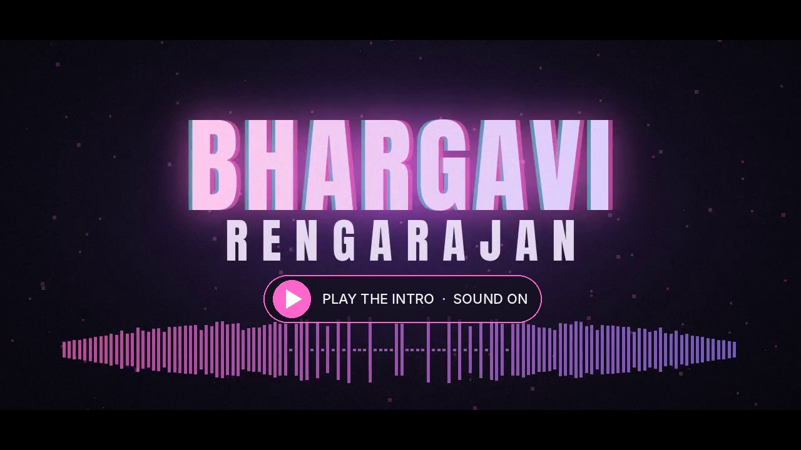
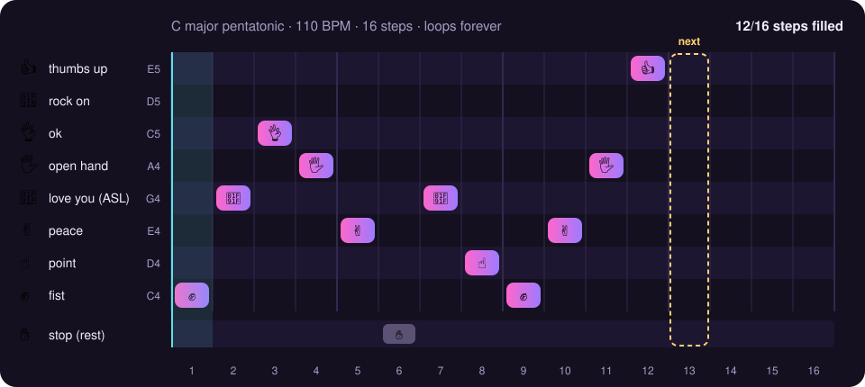
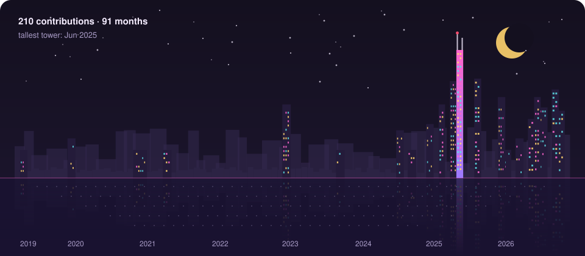

<a href="https://www.linkedin.com/in/bhargavirengarajan21">
  <picture>
    <source media="(prefers-color-scheme: dark)" srcset="./assets/header/header-dark.svg">
    <source media="(prefers-color-scheme: light)" srcset="./assets/header/header-light.svg">
    
  </picture>
</a>

<p align="center">
  <picture>
    <source media="(prefers-color-scheme: dark)" srcset="./assets/beat/beat-dark.svg">
    <source media="(prefers-color-scheme: light)" srcset="./assets/beat/beat-light.svg">
    
  </picture>
</p>

<p align="center">
  <sub>↑ Those bars aren't decoration. They're the sound of the loop <em>you</em> can play further down, redrawn every time someone adds a gesture.</sub>
</p>

<br>

<p align="center">
  <!-- Keep tags adjacent so link whitespace does not appear underlined. -->
  <a href="https://www.linkedin.com/in/bhargavirengarajan21"><picture><source media="(prefers-color-scheme: dark)" srcset="./assets/social/linkedin-dark.svg"><source media="(prefers-color-scheme: light)" srcset="./assets/social/linkedin-light.svg"></picture></a>
  <a href="mailto:bhargavirengarajan21@gmail.com"><picture><source media="(prefers-color-scheme: dark)" srcset="./assets/social/email-dark.svg"><source media="(prefers-color-scheme: light)" srcset="./assets/social/email-light.svg"></picture></a>
  <a href="https://huggingface.co/Bhargavi5q1"><picture><source media="(prefers-color-scheme: dark)" srcset="./assets/social/huggingface-dark.svg"><source media="(prefers-color-scheme: light)" srcset="./assets/social/huggingface-light.svg"></picture></a>
  <a href="https://www.npmjs.com/package/git-commit-at"><picture><source media="(prefers-color-scheme: dark)" srcset="./assets/social/npm-dark.svg"><source media="(prefers-color-scheme: light)" srcset="./assets/social/npm-light.svg"></picture></a>
  <a href="https://github.com/bhargavirengarajan21/linkedin-AI-reply"><picture><source media="(prefers-color-scheme: dark)" srcset="./assets/social/chrome-dark.svg"><source media="(prefers-color-scheme: light)" srcset="./assets/social/chrome-light.svg"></picture></a>
  <a href="https://bhargavi-r-21.vercel.app/"><picture><source media="(prefers-color-scheme: dark)" srcset="./assets/social/portfolio-dark.svg"><source media="(prefers-color-scheme: light)" srcset="./assets/social/portfolio-light.svg"></picture></a>
</p>

<p align="center">
  <a href="https://visitorbadge.io/status?path=https%3A%2F%2Fgithub.com%2Fbhargavirengarajan21"></a>
  
</p>

## Hi! I'm Bhargavi 

I'm a full-stack and AI engineer with about five years of shipping production software in fintech, from Java and Kafka
payment services to React front ends to AI agents that triage incidents before a human wakes up.
I like systems that are boring to operate and delightful to use.

This profile follows one rule: **nothing here sits still**. Press play on the trailer, add a gesture to the loop,
and wander through a skyline built from my commits.

---

## 🎬 The trailer

An original score and title sequence, synthesised from scratch in Python. Turn your sound on.

<p align="center">
  <a href="https://bhargavirengarajan21.github.io/bhargavirengarajan21/#trailer"></a>
</p>

<details>
  <summary><sub>how was this made?</sub></summary>
  <br>

  The music is an original 36-second piece in D minor at 120 BPM: a drone swell, a plucked ostinato, taiko-style drums,
  an accelerating snare roll and riser, half a beat of silence, then a low brass hit on the drop with a saw-wave lead.
  Every sound is synthesised in NumPy (Karplus-Strong strings, pitch-swept kicks, filtered noise, FFT convolution reverb).
  The video frames are drawn with Pillow and react to the audio: the spectrum ribbon is a live FFT of the score,
  and the camera shakes on every drum hit. ffmpeg stitches it together.
  Source: [`generators/intro/music.py`](generators/intro/music.py) · [`generators/intro/intro.py`](generators/intro/intro.py).
</details>

---

## 🖐️ The gesture loop

My first ML project was a music player you control with hand gestures. This is its grandchild:
sixteen steps, **C major pentatonic** over two octaves, 110 BPM, and every note is a gesture.
Pick one below and it lands on the next free step (then wraps around and overwrites).
A workflow redraws the piano roll, synthesises a **WAV** and a **MIDI** file, and repaints the header from the new audio.

<p align="center">
  <picture>
    <source media="(prefers-color-scheme: dark)" srcset="./assets/loop/loop-dark.svg">
    <source media="(prefers-color-scheme: light)" srcset="./assets/loop/loop-light.svg">
    
  </picture>
</p>

<table align="center">
  <tr>
    <td align="center"><a href="https://github.com/bhargavirengarajan21/bhargavirengarajan21/issues/new?title=gesture%3A%20fist&body=Just%20press%20%2A%2ASubmit%20new%20issue%2A%2A.%20A%20workflow%20will%20play%20this%20gesture%20on%20the%20loop%2C%20redraw%20the%20piano%20roll%20and%20the%20header%2C%20then%20close%20this%20issue.%20%F0%9F%8E%B6"><strong>✊</strong><br><sub>C4</sub></a></td>
    <td align="center"><a href="https://github.com/bhargavirengarajan21/bhargavirengarajan21/issues/new?title=gesture%3A%20point&body=Just%20press%20%2A%2ASubmit%20new%20issue%2A%2A.%20A%20workflow%20will%20play%20this%20gesture%20on%20the%20loop%2C%20redraw%20the%20piano%20roll%20and%20the%20header%2C%20then%20close%20this%20issue.%20%F0%9F%8E%B6"><strong>☝️</strong><br><sub>D4</sub></a></td>
    <td align="center"><a href="https://github.com/bhargavirengarajan21/bhargavirengarajan21/issues/new?title=gesture%3A%20peace&body=Just%20press%20%2A%2ASubmit%20new%20issue%2A%2A.%20A%20workflow%20will%20play%20this%20gesture%20on%20the%20loop%2C%20redraw%20the%20piano%20roll%20and%20the%20header%2C%20then%20close%20this%20issue.%20%F0%9F%8E%B6"><strong>✌️</strong><br><sub>E4</sub></a></td>
    <td align="center"><a href="https://github.com/bhargavirengarajan21/bhargavirengarajan21/issues/new?title=gesture%3A%20love-you&body=Just%20press%20%2A%2ASubmit%20new%20issue%2A%2A.%20A%20workflow%20will%20play%20this%20gesture%20on%20the%20loop%2C%20redraw%20the%20piano%20roll%20and%20the%20header%2C%20then%20close%20this%20issue.%20%F0%9F%8E%B6"><strong>🤟</strong><br><sub>G4</sub></a></td>
    <td align="center"><a href="https://github.com/bhargavirengarajan21/bhargavirengarajan21/issues/new?title=gesture%3A%20open-hand&body=Just%20press%20%2A%2ASubmit%20new%20issue%2A%2A.%20A%20workflow%20will%20play%20this%20gesture%20on%20the%20loop%2C%20redraw%20the%20piano%20roll%20and%20the%20header%2C%20then%20close%20this%20issue.%20%F0%9F%8E%B6"><strong>🖐️</strong><br><sub>A4</sub></a></td>
    <td align="center"><a href="https://github.com/bhargavirengarajan21/bhargavirengarajan21/issues/new?title=gesture%3A%20ok&body=Just%20press%20%2A%2ASubmit%20new%20issue%2A%2A.%20A%20workflow%20will%20play%20this%20gesture%20on%20the%20loop%2C%20redraw%20the%20piano%20roll%20and%20the%20header%2C%20then%20close%20this%20issue.%20%F0%9F%8E%B6"><strong>👌</strong><br><sub>C5</sub></a></td>
    <td align="center"><a href="https://github.com/bhargavirengarajan21/bhargavirengarajan21/issues/new?title=gesture%3A%20rock&body=Just%20press%20%2A%2ASubmit%20new%20issue%2A%2A.%20A%20workflow%20will%20play%20this%20gesture%20on%20the%20loop%2C%20redraw%20the%20piano%20roll%20and%20the%20header%2C%20then%20close%20this%20issue.%20%F0%9F%8E%B6"><strong>🤘</strong><br><sub>D5</sub></a></td>
    <td align="center"><a href="https://github.com/bhargavirengarajan21/bhargavirengarajan21/issues/new?title=gesture%3A%20thumbs-up&body=Just%20press%20%2A%2ASubmit%20new%20issue%2A%2A.%20A%20workflow%20will%20play%20this%20gesture%20on%20the%20loop%2C%20redraw%20the%20piano%20roll%20and%20the%20header%2C%20then%20close%20this%20issue.%20%F0%9F%8E%B6"><strong>👍</strong><br><sub>E5</sub></a></td>
    <td align="center"><a href="https://github.com/bhargavirengarajan21/bhargavirengarajan21/issues/new?title=gesture%3A%20stop&body=Just%20press%20%2A%2ASubmit%20new%20issue%2A%2A.%20A%20workflow%20will%20play%20this%20gesture%20on%20the%20loop%2C%20redraw%20the%20piano%20roll%20and%20the%20header%2C%20then%20close%20this%20issue.%20%F0%9F%8E%B6"><strong>✋</strong><br><sub>rest</sub></a></td>
  </tr>
  <tr>
    <td align="center" colspan="9"><a href="https://bhargavirengarajan21.github.io/bhargavirengarajan21/#loop"><strong>▶ listen</strong></a> · <a href="https://github.com/bhargavirengarajan21/bhargavirengarajan21/raw/main/assets/loop/loop.mid"><strong>⬇ MIDI</strong></a></td>
  </tr>
</table>

<p align="center">
<!-- LOOP:CREDITS:START -->
<strong>12/16 steps filled</strong> · next free step: 13 · 0 gestures from visitors<br><sub>recent players: <a href="https://github.com/bhargavirengarajan21">@bhargavirengarajan21</a></sub><br><sub>latest: @bhargavirengarajan21 played 👍 thumbs-up on step 12</sub>
<!-- LOOP:CREDITS:END -->
</p>

<details>
  <summary><sub>why does it always sound good?</sub></summary>
  <br>

  A pentatonic scale has no semitone clashes, so any mix of these eight notes sounds consonant. It's the same trick behind
  the black keys on a piano. Each note is a Karplus-Strong plucked string (a burst of noise fed through a tiny averaging
  delay line) with a dotted-eighth echo, written with Python's standard `wave` module. The MIDI file is written byte by byte.
  Each visitor can play three gestures a day.
  Source: [`generators/loop/loop.py`](generators/loop/loop.py) · header: [`generators/header/header.py`](generators/header/header.py).
</details>

---

## 🌆 The skyline

My GitHub history, drawn as the Chicago skyline on Lake Michigan. Every month I've been on GitHub gets a tower.
Busier months stand taller and light up more windows, quiet months stay low and dark, and the busiest month gets the
spire and twin antennas. It rebuilds every night.

<p align="center">
  <picture>
    <source media="(prefers-color-scheme: dark)" srcset="./assets/skyline/skyline-dark.svg">
    <source media="(prefers-color-scheme: light)" srcset="./assets/skyline/skyline-light.svg">
    
  </picture>
</p>

<p align="center">
<!-- SKYLINE:CREDITS:START -->
<strong>250 contributions · 2018–2026</strong><br><sub>one tower per month · built from my GitHub history · rebuilt nightly</sub>
<!-- SKYLINE:CREDITS:END -->
</p>

<details>
  <summary><sub>how does this work?</sub></summary>
  <br>

  Tower height uses a log scale, so one huge month doesn't flatten the rest. Window count follows the month's share of the
  busiest month. A nightly workflow reads GitHub's contribution calendar through the GraphQL API and merges it with the
  public git history this was first seeded from, so history is never lost. The reflection is the same city flipped and
  faded into the water. Source: [`generators/skyline/skyline.py`](generators/skyline/skyline.py) ·
  data: [`generators/skyline/history.json`](generators/skyline/history.json).
</details>

---

## 🏆 Shipped at work

```console
$ git log --oneline --author="bhargavi" career
a80c1de feat(triage-agent): Claude SDK + MCP subagents do the root-cause analysis and open the ticket; on-call alert noise down 80%
5e17000 feat(payments): Kafka service with retries, DLQ and end-of-day reconciliation; 100% recovery of 17,000 daily events
518b0a7 feat(loans-api): Spring WebFlux PATCH endpoint serving 518,000+ requests a month, idempotent and concurrency-safe
c0ffee4 feat(rag): ask-the-codebase tool over a LangGraph-built vector index, used by on-call engineers and non-engineers alike
4000cc7 feat(compliance): customer-contact eligibility middleware, 4,000+ checks at 180 ms max; 95% of manual review gone
350a11y fix(a11y): WCAG fixes across 100+ pages at Mr. Cooper, an estimated $350K saved
60fa57e perf(web): Gatsby to Next.js server-side rendering, 60% faster pages, Lighthouse 90+
3eng30m feat(tooling): led 3 engineers on banner scaffolding; 3 engineer-days down to 30 minutes (Challenger Q4 Award)
```

---

## 🧰 Toolbox

<p align="center">
  <picture>
    <source media="(prefers-color-scheme: dark)" srcset="./assets/toolbox/toolbox-dark.svg">
    <source media="(prefers-color-scheme: light)" srcset="./assets/toolbox/toolbox-light.svg">
    
  </picture>
</p>

<p align="center"><sub>one SVG, generated from <a href="generators/toolbox/toolbox.yaml">a YAML file</a>, instead of fifty badge requests.</sub></p>

---

## 👩‍💻 Meet the engineer

**Professionally:** I'm a software engineer at Rocket Mortgage on the Integration team, where I build Java and Spring Boot
payment services, Kafka pipelines and the AI tooling our on-call engineers lean on. Before that I spent almost four years at
Mr. Cooper in Chennai, growing from intern to Software Engineer II, leading a small team and mentoring interns.
I hold an **M.S. in Computer Engineering** from UC Riverside, where I did GPU-accelerated computer vision research
and taught labs as a TA.

**As a builder:** I ship side projects people actually install. My LinkedIn reply extension passed 470 installs in its
first month, my commit-message CLI runs on a model I fine-tuned myself, and my Meta hackathon project is an AI
that remembers how a team fixed its last incident.

**Right now:** I'm open to full-time software and AI engineering roles and can start right away.
If you're building something interesting, say hi on **[LinkedIn ↗](https://www.linkedin.com/in/bhargavirengarajan21)**.

<details>
  <summary><sub>a few more things</sub></summary>
  <br>

  - **Debugging is my cardio.** Give me the bug everyone closed as "cannot reproduce."
  - **Local-first fan.** Two of my projects run their LLM on your own machine, so your code and your bank statements stay yours.
  - **Teaching.** I learned the most at UCR by explaining labs to 50+ students.
  - **Competitive streak.** I do coding contests for fun.
</details>

---

## 📓 Noteworthy

<details open>
  <summary><strong>AI, LLMs & agents</strong> <sub>(click to collapse)</sub></summary>
  <br>

  - ✨ [**linkedin-AI-reply**](https://github.com/bhargavirengarajan21/linkedin-AI-reply): Chrome extension that drafts LinkedIn replies for you to edit and never auto-sends. Live on the Chrome Web Store as "AI Reply Drafts for LinkedIn".
  - 🧯 [**Incident Memory**](https://github.com/bhargavirengarajan21/Monitor-dock): AI that remembers how your team fixed things. Built for the Meta Global AI Developer Hackathon.
  - 💰 [**Budget-buddy**](https://github.com/bhargavirengarajan21/Budget-buddy): ask questions about your bank statements, answered by a fully local LLM, with built-in evals of answer quality.
  - 📝 [**git-commit-at**](https://github.com/bhargavirengarajan21/git-commit-at): conventional commit messages from your diff, powered by my [fine-tuned qwen2.5-coder](https://huggingface.co/Bhargavi5q1/git-commit-messages). On [npm](https://www.npmjs.com/package/git-commit-at).
  - 🕸️ [**agent-orchestration**](https://github.com/bhargavirengarajan21/agent-orchestration): TypeScript backend and frontend for coordinating multiple AI agents.
</details>

<details>
  <summary><strong>Full stack</strong> <sub>(click to expand)</sub></summary>
  <br>

  - 📋 [**job-tracker**](https://github.com/bhargavirengarajan21/job-tracker): track applications, manage resume versions, and screen resumes against job descriptions with AI.
  - 🎬 [**netflix-portfolio**](https://github.com/bhargavirengarajan21/netflix-portfolio): a portfolio you browse like a streaming app, built with React and Vite.
  - ✅ [**todo-list**](https://github.com/bhargavirengarajan21/todo-list): Spring Boot app with Spring MVC, Spring Data JPA and Thymeleaf.
</details>

<details>
  <summary><strong>ML & computer vision</strong> <sub>(click to expand)</sub></summary>
  <br>

  - 🎵 [**music-playing-using-hand-gestures**](https://github.com/bhargavirengarajan21/music-playing-using-hand-gestures): real-time gesture recognition that controls a music player. The ancestor of the loop above.
  - 🖼️ [**Electrostatic-halftoning**](https://github.com/bhargavirengarajan21/Electrostatic-halftoning): physics-inspired dithering and stippling for images.
  - 💨 [**airpollution**](https://github.com/bhargavirengarajan21/airpollution): Random Forest and XGBoost models predicting PM10 levels from Delhi air-quality data, served with Flask.
</details>

<details>
  <summary><strong>Studies & certifications</strong> <sub>(click to expand)</sub></summary>
  <br>

  - 🎓 **M.S. Computer Engineering**, University of California, Riverside · GPA 3.7
  - 🎓 **B.E. Computer Science**, Thiagarajar College of Engineering (Anna University)
  - 📄 **IEEE publication** on machine-learning-based spatial hazard assessment
  - ☁️ **Microsoft Certified: Azure Fundamentals (AZ-900)**
  - 🤖 **Claude with the Anthropic API**, Anthropic
</details>

---

## 🖇️ Let's connect

I'm always up for talking shop about distributed systems, AI agents, or whatever you're building.

<p align="center">
  <a href="https://www.linkedin.com/in/bhargavirengarajan21">💼 LinkedIn</a> ·
  <a href="mailto:bhargavirengarajan21@gmail.com">✉️ Email</a> ·
  <a href="https://huggingface.co/Bhargavi5q1">🤗 Hugging Face</a> ·
  <a href="https://bhargavi-r-21.vercel.app/">🌐 Portfolio</a>
</p>

---

<details>
  <summary><sub>🔧 how this page is built</sub></summary>
  <br>

  | piece | source | trigger |
  |---|---|---|
  | header waveform | [`generators/header/header.py`](generators/header/header.py) | whenever the loop changes |
  | gesture loop (SVG, WAV, MIDI) | [`generators/loop/loop.py`](generators/loop/loop.py) | visitor issues titled `gesture: …` |
  | commit skyline | [`generators/skyline/skyline.py`](generators/skyline/skyline.py) | nightly |
  | toolbox | [`generators/toolbox/toolbox.py`](generators/toolbox/toolbox.py) | on push to its YAML |
  | social buttons | [`generators/social.py`](generators/social.py) | on push to generators |
  | Chicago house equalizer (SVG + GIF) | [`generators/beat/beat.py`](generators/beat/beat.py) | manually |
  | trailer (MP4 + poster) | [`generators/intro/`](generators/intro) | manually: `python generators/intro/intro.py` |
  | player page (trailer + loop audio) | [`docs/index.html`](docs/index.html) on GitHub Pages | redeploys on every push |
  | glue | [`generators/playground.py`](generators/playground.py) · [`.github/workflows/`](.github/workflows) | — |

  Every SVG comes in a dark and a light variant, picked with `<picture>` and `prefers-color-scheme`.
  Everything is plain Python with NumPy and PyYAML; no image services, no third-party actions beyond checkout and setup-python.
  Inspired by [Marie-Lynne Block's living README](https://github.com/MarieLynneBlock).
</details>

<p align="center"><sub>Built with 💗 and a lot of ☕ by Bhargavi Rengarajan · ©2026 · nothing on this page sits still</sub></p>
